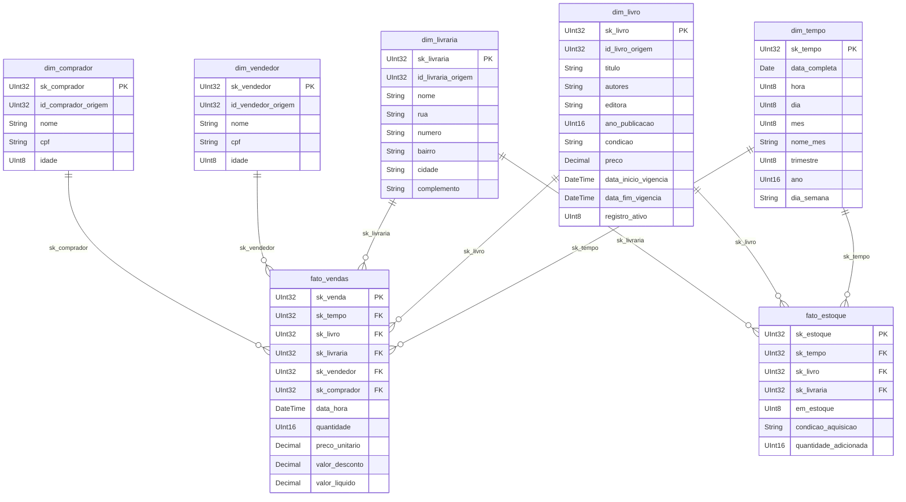

# Atividade 5 – Data Warehouse (Rede de Livrarias)

Projeto completo de Data Warehouse utilizando **ClickHouse** (via Docker) para modelagem multidimensional em **Constelação de Fatos (Galaxy Schema)** com **SCD Tipo 2** para histórico de preços, alimentado a partir de um banco transacional (**OLTP** em SQLite) via script **ETL** em Python.

---

## Modelo Multidimensional (Constelação de Fatos)



---

## Como Executar

### 1. Subir o ClickHouse (Tarefa 1)
```powershell
docker compose up -d
```

### 2. Criar OLTP, Criar DW e Executar ETL (Tarefas 3 e 4)
```powershell
python scripts/etl_carga_dw.py
```

### 3. Executar Consultas Analíticas na Interface Web do ClickHouse
Acesse no navegador: **http://localhost:8123/play**
- **Usuário:** `admin`
- **Senha:** `admin123`

Cole e execute as consultas de [`sql/03_consultas_analiticas.sql`](sql/03_consultas_analiticas.sql).

---

## Estrutura do Projeto
- `docker-compose.yml` — Container do ClickHouse Server.
- `sql/01_oltp_schema_seed.sql` — Banco transacional (OLTP) da rede de livrarias + dados iniciais.
- `sql/02_dw_schema.sql` — DDL do Data Warehouse no ClickHouse (`livraria_dw`).
- `scripts/etl_carga_dw.py` — Script ETL (extração do OLTP, carga inicial e atualização SCD Tipo 2).
- `sql/03_consultas_analiticas.sql` — Consultas respondendo às 6 perguntas de negócio do enunciado.
- `ROTEIRO_VIDEO.md` — Roteiro cronometrado para a gravação do vídeo de até 5 minutos.
